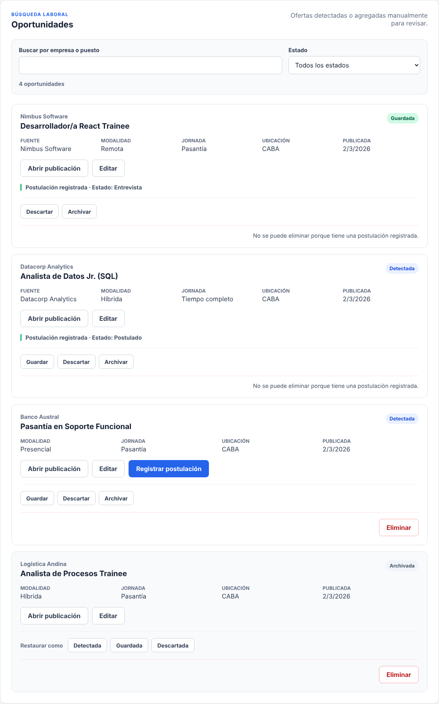
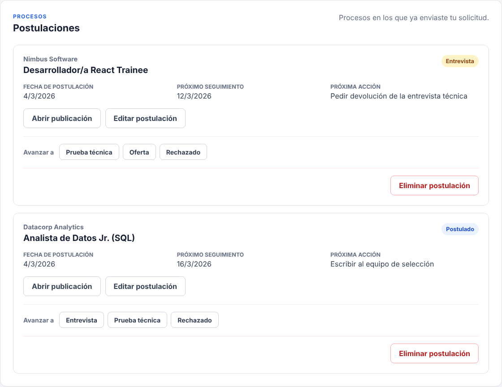
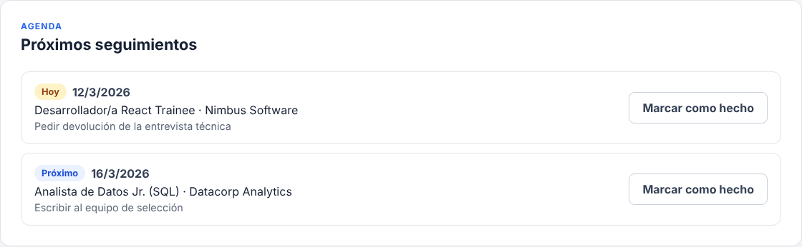
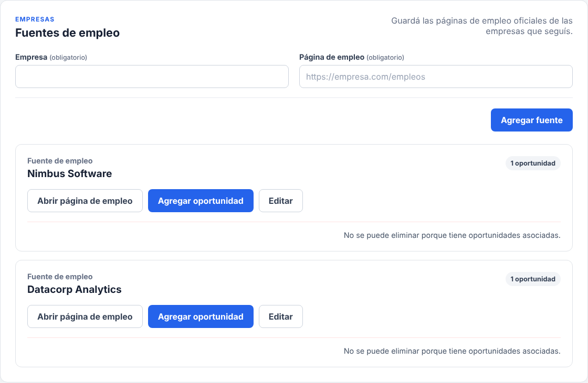

# Gestor de Postulaciones IT

Aplicación web para organizar una búsqueda laboral en tecnología: registrá las ofertas que encontrás, decidí en cuáles postularte y seguí cada proceso hasta el final.

**Usala online:** https://tato22-alt.github.io/gestor-postulaciones-it/

No requiere cuenta. Tus datos se guardan en tu navegador y, si querés, se sincronizan con tu propio Google Drive para usarlos en todos tus dispositivos.



## Funcionalidades

**Oportunidades**

* carga manual de ofertas con empresa, puesto, enlace, ubicación, modalidad, jornada, fecha de publicación y descripción;
* estados Detectada, Guardada, Descartada y Archivada, con transiciones controladas;
* edición y eliminación con confirmación;
* búsqueda por empresa o puesto (sin distinguir mayúsculas ni acentos) y filtro por estado;
* aviso cuando una oferta tiene el mismo enlace que otra ya cargada.

**Postulaciones**

* registro de una postulación a partir de una oportunidad, con confirmación;
* estados Postulado, Entrevista, Prueba técnica, Oferta y Rechazado;
* fecha de postulación, próxima acción y notas editables;
* eliminación con confirmación, conservando la oportunidad.



**Seguimientos**

* fecha de seguimiento sugerida según la etapa (7 días después de postularte, 3 después de una entrevista y 5 después de una prueba técnica), siempre editable;
* agenda ordenada por fecha con etiquetas «Vencido», «Hoy» y «Próximo».



**Fuentes de empleo**

* páginas de empleo oficiales de las empresas que seguís, con acceso directo;
* carga de oportunidades desde una fuente, que queda asociada a la oferta.



**Perfil**

* skills cargadas como texto libre, una por vez, sin repetir (mayúsculas, acentos y espacios no cuentan como diferencia);
* por ahora solo se guardan: todavía no se comparan con las oportunidades.

**Tus datos**

* sincronización opcional con tu Google Drive: conectás tu cuenta una vez y tus datos quedan disponibles en la computadora y en el celular;
* respaldo en un archivo JSON para guardar una copia o pasar los datos a otro navegador;
* importación de respaldos que solo agrega lo nuevo, con vista previa;
* exportación de oportunidades y postulaciones a CSV para abrirlas en una planilla;
* el respaldo incluye oportunidades, postulaciones, fuentes y las skills del perfil.

**Estadísticas**

* resumen por estado, modalidad, jornada y fecha de publicación;
* postulaciones en curso y seguimientos vencidos o para hoy.

## Cómo se usa

1. En **Oportunidades**, agregá cada oferta que te interese con «Agregar oportunidad». Si seguís a una empresa, guardá su página de empleo en **Fuentes** y cargá sus ofertas desde ahí.
2. Cuando te postules, presioná «Registrar postulación» en su tarjeta.
3. En **Postulaciones**, avanzá el estado de cada proceso y editá fechas, próxima acción y notas.
4. Revisá **Próximos seguimientos** para saber a quién escribir y cuándo. Marcá cada seguimiento como hecho al completarlo.
5. En **Perfil**, cargá tus skills.
6. Para usar la app en varios dispositivos, tocá «Conectar Google Drive» en cada uno. También podés exportar un respaldo en **Tus datos** e importarlo en otro navegador.

## Privacidad

La información queda en el `localStorage` del navegador que usás. Si conectás Google Drive, la app guarda una copia en una carpeta privada de tu propia cuenta, a la que solo ella accede y que no le permite ver tus otros archivos. Los datos nunca pasan por un servidor propio de la app. Más detalles en la [política de privacidad](https://tato22-alt.github.io/gestor-postulaciones-it/privacidad.html).

## Tecnologías

* React 19 y Vite;
* JavaScript y CSS;
* `localStorage` del navegador;
* Google Identity Services y la API de Google Drive (carpeta privada de la app);
* pruebas con `node:test`, el ejecutor nativo de Node.js;
* GitHub Actions y GitHub Pages.

## Arquitectura

El código está organizado en capas con responsabilidades separadas:

```text
src/components      Presentación: componentes React, formularios y accesibilidad
src/application     Casos de uso puros: crear, editar, filtrar, calcular métricas, importar
src/domain          Entidades y reglas del negocio: estados, transiciones, seguimientos
src/infrastructure  Almacenamiento: localStorage, formato del respaldo, descargas y Google Drive
```

Los componentes no acceden al almacenamiento directamente. Los datos guardados y los archivos importados se validan antes de convertirse en entidades del dominio, y nunca se sobrescriben datos que no se pudieron leer.

## Desarrollo

```bash
npm install
npm run dev -- --host 127.0.0.1
```

La app queda disponible en `http://127.0.0.1:5173/`. Para probar la sincronización localmente, copiá `.env.example` como `.env.local` y completá `VITE_GOOGLE_CLIENT_ID`. Cada combinación de host y puerto guarda sus propios datos: `127.0.0.1` y `localhost` no los comparten.

### Verificación

```bash
npm run lint
npm test
npm run build
```

Las pruebas unitarias cubren las reglas del dominio, los casos de uso, la validación de formularios, el respaldo, la exportación a CSV y el almacenamiento, incluidos datos dañados y archivos maliciosos.

### Publicación

Cada push a `main` ejecuta el workflow `.github/workflows/deploy.yml`: instala dependencias, corre lint y pruebas, compila y publica la carpeta `dist` en GitHub Pages. Si alguna verificación falla, no se publica.

## Autor

Luciano Dominguez  
Estudiante de la Licenciatura en Gestión de Tecnología de la Información — UADE.
