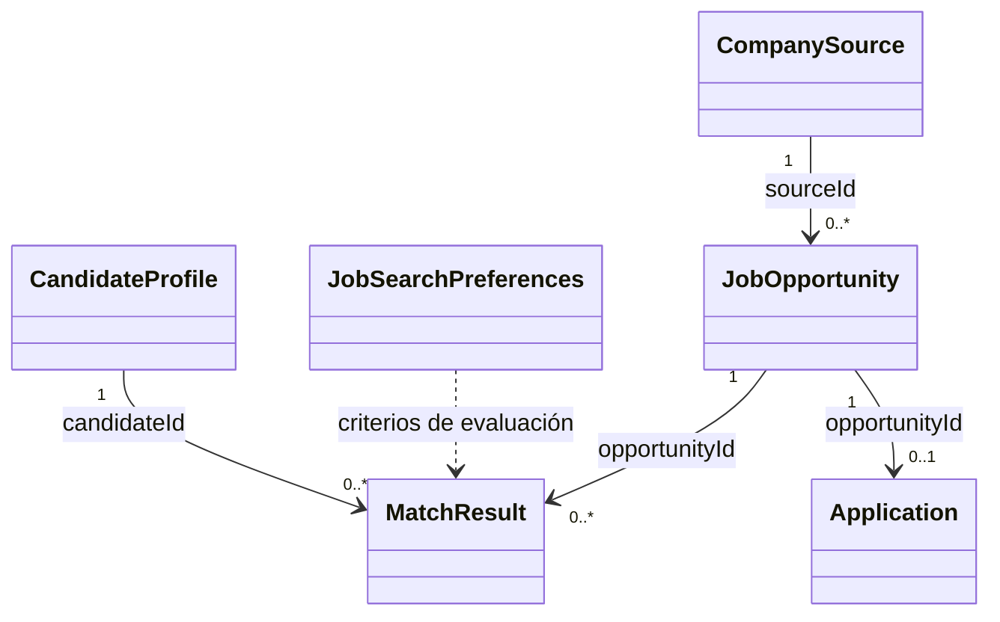

# Modelo de dominio

## Propósito

El modelo de dominio representa los conceptos principales del asistente de búsqueda laboral sin depender de React, persistencia ni servicios externos. Las clases almacenan datos del negocio; todavía no ejecutan automatizaciones ni reglas de evaluación.

## Clases y responsabilidades

### `CandidateProfile`

Representa información profesional no sensible y relativamente estable de una persona candidata: formación, habilidades, idiomas y referencia al CV. No contiene preferencias de búsqueda ni lógica de postulaciones.

Hoy se editan y se guardan las skills (`skills`) y el texto del CV (`cvText`), junto con `id`, `createdAt` y `updatedAt`. Hay un único perfil por persona. Las reglas viven en `candidateSkillsPolicy.js`: cada skill es texto libre de hasta 60 caracteres, con como máximo 100 skills, y dos skills que solo difieren en mayúsculas, acentos o espacios se consideran la misma. El texto del CV sigue `cvPolicy.js`: hasta 20.000 caracteres, con espacios normalizados y párrafos conservados. Antes de mandar el CV a la IA, `redactContactData` quita mails, links, teléfonos, DNI y CUIL/CUIT; el nombre no se puede detectar de forma confiable y puede quedar. El resto de los campos de la clase todavía no se usa ni se persiste.

### `JobSearchPreferences`

Representa criterios configurables para una búsqueda laboral, como roles objetivo, modalidades, tolerancias y preferencias de notificación. No contiene identidad del candidato ni valores hardcodeados para una persona específica.

Hoy se editan y se guardan los roles buscados (`targetRoles`, texto libre de hasta 80 caracteres y como máximo 20 roles), las modalidades preferidas (`preferredModalities`) y los tipos de jornada aceptados (`acceptedEmploymentTypes`), que reutilizan los valores controlados de las oportunidades. Hay un único conjunto de preferencias por persona, con `id`, `createdAt` y `updatedAt` para la sincronización. Las reglas viven en `jobSearchPreferencesPolicy.js`. El resto de los campos todavía no se usa ni se persiste.

Los rangos pueden expresarse con objetos `{ min, max }`. Por ejemplo, `travelTimeRangeHours` puede representar entre cuatro y cinco horas, y `weeklyOpportunityTarget` entre tres y cinco oportunidades. Los criterios no configurados permanecen en `null` o en colecciones vacías.

### `CompanySource`

Representa una fuente oficial de empleos de una empresa. Una fuente nueva comienza pendiente y debe pasar a estado aprobado antes de que una futura infraestructura pueda monitorearla. Las fuentes que el usuario agrega a mano se crean aprobadas, porque es el propio usuario quien las elige; no se monitorean. Una fuente con oportunidades asociadas no puede eliminarse.

### `JobOpportunity`

Representa una oferta detectada o ingresada manualmente. Conserva información como empresa, puesto, URL, publicación, requisitos y fuente de origen. La URL se usa para avisar sobre posibles duplicados.

`duplicateOpportunityPolicy.js` define una señal mínima de posible duplicado: dos oportunidades apuntan a la misma publicación cuando sus URLs coinciden después de pasar protocolo y host a minúsculas, quitar el `#fragmento` y quitar la barra final. La coincidencia solo genera un aviso; nunca bloquea, fusiona ni elimina oportunidades.

El ciclo de vida de una oportunidad está controlado por cuatro estados: `detected`, `saved`, `dismissed` y `archived`. Las transiciones permitidas están centralizadas en `opportunityStatusPolicy.js`: desde detectada se puede avanzar a guardada, descartada o archivada; desde guardada o descartada se puede cambiar entre sí o archivar; desde archivada se puede restaurar a cualquiera de los otros tres estados. Las auto-transiciones y los retrocesos de guardada o descartada a detectada están siempre bloqueados. Ningún componente visual ni función de aplicación inventa reglas de transición fuera de esa política.

El atributo `salary` puede almacenar por separado `amount`, `currency`, `period` y `condition` cuando la publicación los informa. Todo dato salarial desconocido puede permanecer en `null`; no se realizan conversiones.

### `MatchResult`

Representa el resultado de evaluar un perfil y sus preferencias contra una oportunidad. Puede contener puntaje, recomendación, fortalezas, advertencias, habilidades faltantes y datos desconocidos (`unknowns`). No calcula nada por sí mismo.

Hoy lo produce `analyzeCompatibility` (`compatibilityPolicy.js`) en una primera versión sin puntaje ni recomendación (`score` y `recommendation` quedan en `null`). Cada elemento es un tipo controlado más los valores relacionados; los textos visibles viven en la interfaz. Las reglas son:

- **Skills:** una skill es una fortaleza si aparece como palabra completa en el título o la descripción, sin distinguir mayúsculas ni acentos («Java» no coincide con «JavaScript» ni «C» con «C++»). Si no aparece ninguna, o no hay descripción, es un dato desconocido, nunca negativo, porque la publicación puede no listar todo.
- **Roles buscados:** si el título contiene un rol, es una fortaleza; si no, es un dato desconocido, porque los títulos varían mucho.
- **Modalidad y jornada:** si coinciden con las preferencias, fortaleza; si son conocidas y no coinciden, advertencia (no un rechazo); si la oportunidad no las indica, dato desconocido.
- **Skills requeridas:** si la oportunidad tiene `requiredSkills`, las que el perfil incluye son una fortaleza y las demás van a `missingSkills`. Las skills requeridas no se repiten como «mencionadas».
- Un criterio que el usuario no configuró no se evalúa.

`JobOpportunity.requiredSkills` se carga a mano o a partir de sugerencias de IA que el usuario revisa y confirma; siguen las mismas reglas de texto que las skills del perfil.

El resultado se deriva en cada renderizado y no se guarda, así siempre refleja los datos actuales.

### `Application`

Representa una postulación efectivamente realizada. Referencia la oportunidad original y conserva el estado del proceso, las fechas de postulación y seguimiento, la próxima acción y las notas.

Las reglas de registro están centralizadas en `applicationRegistrationPolicy.js`: solo puede registrarse una postulación para una oportunidad en estado `detected` o `saved`, y cada oportunidad puede tener como máximo una postulación. Registrar una postulación no modifica el estado de la oportunidad.

El ciclo de vida de una postulación está controlado por `applicationStatusPolicy.js`: desde `applied` se puede avanzar a `interview`, `technical_test` o `rejected`; `interview` y `technical_test` pueden alternarse entre sí y avanzar a `offer` o `rejected`; `offer` y `rejected` son estados finales sin transiciones de salida.

Los seguimientos están centralizados en `followUpPolicy.js`. Al registrar una postulación se sugiere un seguimiento 7 días después; al pasar a `interview`, 3 días después; al pasar a `technical_test`, 5 días después. Los estados finales no tienen seguimiento y lo borran. La sugerencia es editable. `followUpAt` se almacena como fecha de calendario `YYYY-MM-DD` para que represente el mismo día en cualquier zona horaria; `appliedAt` sigue siendo un instante ISO. `nextAction` admite hasta 200 caracteres y `notes` hasta 2000.

Una oportunidad que tiene una postulación registrada no puede eliminarse. Qué debería ocurrir con la postulación si en el futuro se permite esa eliminación es una decisión de producto pendiente.

## Relaciones

- `CompanySource` puede originar varias oportunidades.
- `MatchResult` vincula un candidato con una oportunidad y considera sus preferencias vigentes.
- `Application` referencia la oportunidad que el usuario decidió convertir en una postulación real.

## Oportunidad y postulación

`JobOpportunity` existe desde que una oferta entra al sistema. Su estado avanza por una política de transiciones explícita: puede guardarse, descartarse o archivarse desde detectada; puede moverse entre guardada, descartada y archivada; y puede restaurarse desde archivada. El usuario puede cambiar el estado mediante los botones de acción de la tarjeta o a través del formulario de edición. Una oportunidad también puede eliminarse permanentemente desde cualquier estado mediante el botón de eliminación de la tarjeta; la operación requiere confirmación explícita y no puede deshacerse.

`Application` existe únicamente después de una postulación efectiva y de una confirmación explícita del usuario en la interfaz. La aplicación nunca envía postulaciones a empresas: solo registra una acción que el usuario ya realizó. Por eso `applied` no es un estado de oportunidad y `saved` no es un estado de postulación.

## Perfil y preferencias

`CandidateProfile` almacena hechos profesionales sobre la persona. `JobSearchPreferences` almacena decisiones configurables sobre la búsqueda. Separarlos permite cambiar prioridades, tolerancias o modalidades sin alterar la información profesional del candidato.

## Flujo conceptual

1. Se descubre una fuente oficial y se registra como pendiente.
2. El usuario aprueba la fuente antes de cualquier monitoreo.
3. Una oferta entra al sistema como `JobOpportunity` detectada.
4. `analyzeCompatibility` compara la oportunidad con el perfil y las preferencias.
5. El resultado se muestra como `MatchResult` derivado, sin almacenarse.
6. El usuario revisa la oportunidad y decide si desea postularse.
7. Solo después de una postulación efectiva se crea `Application`.
8. La aplicación registra el avance y los seguimientos del proceso.

## Datos sensibles excluidos

El modelo no almacena DNI, CUIL, pasaporte, domicilio exacto, contraseñas, credenciales de portales, datos bancarios, documentos personales, tokens ni API keys. `CandidateProfile` se limita a información profesional no sensible.

## Funcionalidades no implementadas

Todavía no existen:

- validaciones de campos obligatorios;
- instancias con información de Luciano;
- repositorios para resultados de compatibilidad (las fuentes, las skills del perfil y las preferencias de búsqueda ya tienen su repositorio local y se sincronizan con Drive);
- edición de las preferencias distintas de roles, modalidades y tipos de jornada;
- edición de los campos del perfil distintos de las skills;
- monitoreo de fuentes;
- scraping o consumo de APIs de empleo;
- fusión automática de duplicados;
- cálculo de puntajes o recomendaciones;
- pesos de compatibilidad;
- conversiones salariales;
- envío de notificaciones;
- autenticación;
- inteligencia artificial.

La interfaz React ya utiliza `JobOpportunity` para representar las oportunidades cargadas manualmente y `Application` para las postulaciones registradas. La infraestructura local persiste cada colección con su propio repositorio (`LocalStorageOpportunityRepository` y `LocalStorageApplicationRepository`), valida el formato almacenado y rehidrata instancias reales de las clases. El modelo de dominio continúa sin depender de React, `localStorage` ni de los repositorios.

Los valores `null` representan información no disponible o aún no configurada; no constituyen una categoría de negocio adicional.
